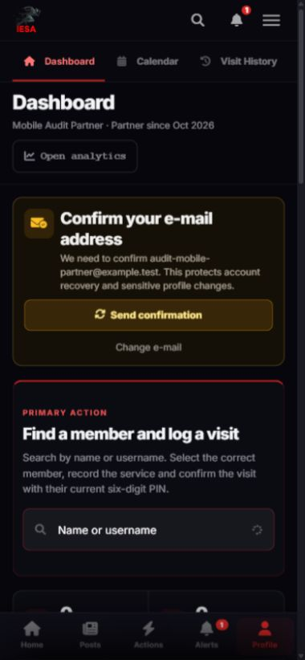
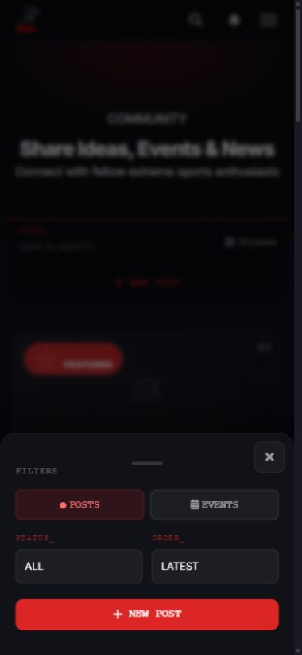
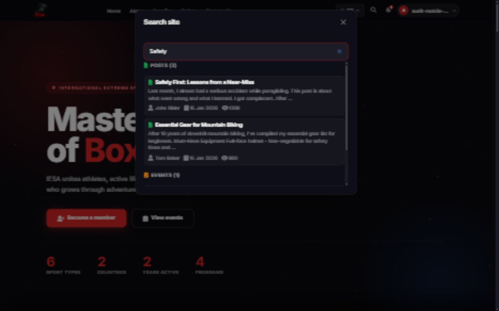

# IESA: проект интерфейса администрации

Дата: 13 октября 2026. Проект, без реализации новых административных экранов.

## 1. Продуктовая задача

Человек из администрации приходит на сайт, видит ожидающие его задачи и выполняет их без знакомства с Django. Панель должна объяснять, что произошло, кому это повлияет и что можно сделать дальше. Служебные поля базы данных заменяются рабочими сценариями; важные ограничения не прячутся в инструкции.

Основной пользователь — сотрудник, который знает работу ассоциации, но не программирование. Его частые задачи: рассмотреть заявки, проверить публикации, помочь участнику с картой, изменить мероприятие, работать с партнёрами. Разработчик дополнительно управляет доступом и диагностикой.

Первый выпуск использует серверные Django-шаблоны, существующие Bootstrap и HTMX. Новый SPA и новый визуальный язык не нужны. Общие формы и проверки должны работать при обычном POST, а HTMX улучшает скорость без создания второго поведения.

## 2. Что уже есть и что берём за основу

Все ссылки на исходники ниже относительны к этому документу. Они указывают на реальные элементы сайта, а не сторонние примеры.

| Решение панели | Основа в IESA | Как адаптировать |
|---|---|---|
| Общая шапка, язык, поиск, уведомления, личный аккаунт | [`_navbar.html`](../../templates/partials/_navbar.html), [`base.html`](../../templates/base.html) | Сохраняем верхний уровень сайта; добавляем вход «Управление IESA» по правам |
| Боковое меню, заголовок раздела, рабочая область | [`partner_base.html`](../../users/templates/users/partner_base.html), [`dashboard.css`](../../static/css/dashboard.css) | Выделяем общий workspace-shell, не дублируем целиком партнёрскую оболочку |
| Первое важное действие и краткая статистика | [`partner_dashboard.html`](../../users/templates/users/partner_dashboard.html) | Вместо поиска для визита — «Требует внимания» и очередь задач |
| Поиск в разделе, статус, порядок, фильтры | [`post_list.html`](../../blog/templates/blog/post_list.html), [`cmd-bar.css`](../../static/css/cmd-bar.css) | Сохраняем структуру панели; используем обычные подписи «Статус», «Сначала новые» вместо `STATUS_` |
| Карточки публикаций и просмотр материала | [`posts_list_fragment.html`](../../blog/templates/blog/htmx/posts_list_fragment.html), [`post_detail.html`](../../blog/templates/blog/post_detail.html) | Показываем материал в том же оформлении, в котором его увидит участник |
| Формы и данные человека | [`profile_edit.html`](../../users/templates/users/profile_edit.html), [`profile.html`](../../users/templates/users/profile.html) | Повторяем группировку полей, статусы и спокойную последовательность; административные действия выносим отдельно |
| Карточка организации и история работы | [`partner_profile_edit.html`](../../users/templates/users/partner_profile_edit.html), [`partner_member_visits.html`](../../users/templates/users/partner_member_visits.html) | Используем существующие сведения, формы и историю; добавляем административный контекст |
| Календарь и создание встречи | [`partner_calendar.html`](../../users/templates/users/partner_calendar.html) | Для мероприятий используем знакомое поведение дат и списка дня |
| Короткие мобильные фильтры и действия | `IESABottomSheet` в [`base.html`](../../templates/base.html) | Один открытый слой, явное закрытие, возврат фокуса; длинные формы — отдельные страницы |
| Поиск сайта | [`_site_search.html`](../../templates/partials/_site_search.html), [`site-search.js`](../../static/js/site-search.js) | Публичный поиск сохраняем; закрытые административные результаты доступны только внутри панели |
| Цвета, типографика, расстояния, кнопки | [`variables.css`](../../static/css/variables.css), [`components.css`](../../static/css/components.css), корневой `STYLEGUIDE.md` | Используем текущие токены. Тёмное оформление, красный акцент IESA; у действий всегда есть текст, статус не определяется одним цветом |

Перед реализацией компонент сверяется с последним master. Текущие скриншоты относятся к проверке 13 октября; на master уже есть дополнительные улучшения оформления, которые нужно сохранить.

### Визуальные опоры существующего сайта



Партнёрский кабинет задаёт ритм: заголовок, конкретная задача, затем статистика и история. Для администрации та же последовательность удобнее, чем стартовая сетка всех моделей Django.



Этот нижний лист подходит для фильтров и короткого выбора. Назначение прав с несколькими шагами в него не помещаем.



Сохраняем поиск и ясное разделение результатов. Административный поиск получает свою область и не расширяет публичную выдачу приватными данными.

## 3. Вход и общая навигация

Новый адрес — `/manage/`. В меню аккаунта, личном кабинете и мобильном меню появляется одинаковая ссылка «Управление IESA», если у пользователя есть хотя бы одно активное назначение. Никакой дополнительный логин для обычной работы не нужен. Подтверждение личности потребуется только для чувствительных операций.

После входа открывается «Обзор» с задачами доступных разделов. Если человеку доступен только один рабочий раздел, первым открывается он. В меню остаётся пункт «Обзор», чтобы поведение не менялось неожиданно после расширения доступа. Прямая ссылка из уведомления открывает нужную заявку, сохраняя контекст списка.

Действия в шапке: «На сайт», поиск по управлению, уведомления и аккаунт. Разработчик видит дополнительную ссылку «Техническая админка»; обычный сотрудник её не видит. Рядом с именем — роль и область: «Менеджер партнёров · 3 организации». При нескольких назначениях показываем «Несколько ролей» и раскрываем состав по нажатию.

### Разделы

| Пункт | Содержание | Основной маршрут, предлагается |
|---|---|---|
| Обзор | Очереди, задачи, недавние действия | `/manage/` |
| Заявки | Смена типа аккаунта, страховые обращения, обращения к администрации | `/manage/requests/` |
| Участники | Профили, членство, проверка, карты, приглашения | `/manage/members/` |
| Сообщество | Публикации и комментарии | `/manage/community/` |
| Мероприятия | События, регистрации, календарь | `/manage/events/` |
| Партнёры | Рабочие организации, визиты, встречи, назначенные сотрудники | `/manage/partners/` |
| Контент сайта | Главная, публичные партнёры, преимущества, продукты, галерея, соцсети | `/manage/content/` |
| Сообщения | Черновики и отправка административных уведомлений | `/manage/messages/` |
| Команда и доступ | Люди, назначения, шаблоны ролей | `/manage/team/` |
| История действий | Поиск административных событий | `/manage/audit/` |
| Настройки | Поддерживаемые настройки сайта и свои уведомления | `/manage/settings/` |

Недоступные разделы не занимают место. Внутри доступного раздела недоступные редкие действия скрываем; если объяснение полезно, показываем текст «Только просмотр» и доступную связь с ответственным. Меню строится по правам сервера, а не по `is_staff`.

**Два разных партнёра в коде:** `users.Partner` — рабочая организация и кабинет; `core.Partner` — публичная карточка на сайте. В панели называем их «Организации» и «Публичные карточки партнёров». Автоматически связывать их по названию нельзя. Явная связь предлагается отдельной миграцией, после проверки данных; до неё — подсказка и переход между разделами.

## 4. Компоновка на ПК и телефоне

### ПК, от 992 px

Сохраняем общий header IESA. Ниже — оболочка кабинета: боковое меню ориентировочно 240–260 px и рабочая область. Меню не выдавливает контент на ширине 1024 px. Максимальная ширина длинной формы — около 900 px, оставшееся место можно использовать для резюме и истории. Размеры уточняются по существующим токенам и реальному контенту.

В рабочей области: хлебные крошки → заголовок и главное действие → поиск/фильтры → результат → пагинация. У списков 25 объектов на страницу; выбор 50 доступен там, где полезен. Детали открываются полноценной страницей. Короткий просмотр возможен боковой панелью на широком экране, но всегда имеет ссылку «Открыть страницу».

Пример обзора для операционного администратора:

```text
Шапка IESA                 Поиск по управлению | Уведомления | Аккаунт
Меню             Обзор · Управление IESA
                 Требует внимания
Обзор            [Заявки: 8] [Публикации: 12] [Обращения: 3]
Заявки           Мои задачи                   Недавние действия
Участники        Заявка Анны · 2 часа          Карта выдана · Сергей
Сообщество       Пост о турнире · 4 часа      Публикация одобрена · Мария
...              [Открыть очередь]
```

Счётчики показывают только доступный пользователю набор данных. Суммарные цифры не раскрывают существование чужих приватных заявок.

### Телефон, 360–767 px

Верхняя строка: назад/название, поиск, уведомления; меню разделов открывается явной кнопкой. Нижняя навигация в контексте `/manage/` содержит «Обзор», «Задачи», «Поиск», «Разделы». «Задачи» — только доступные очереди. Переключение обратно на сайт явно возвращает обычную нижнюю навигацию IESA. Одновременно две нижние панели не отображаются.

Списки превращаются в карточки: заголовок, человек/организация, статус с текстом, дата и одно основное действие. Телефонные номера, email и названия не обрезаются до неузнаваемости; второстепенные сведения раскрываются внутри карточки. Полная информация остаётся в деталях. Таблица ролей превращается в сгруппированные списки прав; горизонтальный скролл не нужен для выдачи доступа.

```text
‹ Заявки                    Поиск   Уведомления
Поиск по имени или номеру
[Все типы] [Ожидают · 8] [Фильтры · 2]
Анна Петрова
Стать партнёром · Ожидает рассмотрения
Сегодня, 10:35
[Рассмотреть]
...
Обзор       Задачи       Поиск       Разделы
```

Страница заявки:

```text
‹ Заявки                   Заявка №184
Анна Петрова · Стать партнёром
Ожидает рассмотрения
Что просит / Контакт / Организация
Проверка перед решением
История заявки
────────────────────────────────────────
[Вернуть / отклонить]       [Одобрить]
```

Панель действий в деталях закрепляется снизу вместо обычной нижней навигации, с учётом `safe-area-inset-bottom`. Она не перекрывает последние поля и ошибки. При открытии клавиатуры важно видеть текущее поле и возможность прокрутки. Большую форму не открываем поверх другой формы.

### Планшет, 768–991 px

Используем сворачиваемое меню, две колонки карточек там, где текст помещается. Форма и права остаются одноколоночными. Календарь может быть сеткой с открытием дня. Проверяем обе ориентации, включая длинные французские и немецкие подписи.

### Общие правила адаптации

- Одни серверные действия и имена полей на всех ширинах. CSS меняет представление, не доступность функций.
- Все функции доступны нажатием и клавиатурой; hover и swipe только дополняют явные кнопки.
- Сенсорные цели не меньше 44×44 CSS px. Отдельные соседние опасные и обычные действия не соприкасаются.
- Для шторок и модальных окон: заголовок, кнопка закрытия, Escape, управляемый фокус, возврат на исходную кнопку. Browser Back закрывает временный слой перед уходом со страницы, без сломанной истории.
- Закреплённая строка не накрывает клавиатуру, нижнее меню или системную область телефона. Проверка на реальном iOS Safari входит в приёмку.

## 5. Экран «Обзор»

Показываем приветствие без маркетингового hero, текущую роль/область и максимум четыре полезных счётчика. Клик по счётчику открывает уже отфильтрованный список. Ниже — «Требует внимания», затем последние действия команды, доступные по правам.

Для модератора: ожидающие публикации, возвращённые материалы, последние решения. Для сотрудника по участникам: новые заявки, обращения, карты. Для координатора: ближайшие события и регистрации. Не показываем финансовые показатели человеку без права аналитики.

Пустой обзор: «Сейчас нет задач на проверке», ссылка на рабочий раздел. Отсутствие прав: «Рабочий доступ не назначен» с возвращением на сайт; технический статус сотрудника не показываем как ошибку системы.

## 6. «Заявки»: одна очередь для понятной работы

Три типа: смена статуса аккаунта, запрос страхового агента, обращение к администрации. Статусы разных моделей не превращаем в один общий статус в БД. В интерфейсе общий список с типом и исходным статусом. Фильтры: тип, статус, дата; ответственный появляется только после внедрения соответствующего поля.

Строка/карточка: номер, заявитель, тип, дата, статус, ответственный (если назначен). Основное действие «Рассмотреть». Поиск по имени и номеру не возвращает чужие заявки. Email доступен только по праву контактных данных.

Страница заявки делится на четыре блока: «Запрос человека», «Связанные сведения», «Решение», «История». Полный комментарий заявителя отображается безопасно. Внутренний комментарий явно отмечен «Виден только администрации». Причина отказа отмечена «Будет отправлена заявителю»; эти поля никогда автоматически не копируются друг в друга.

### Одобрение смены статуса

1. Сотрудник читает запрос и текущий статус.
2. Панель показывает последствия: «Будет создан кабинет партнёра для …» или «Изменится бизнес-статус». Существующий профиль обнаруживается заранее; повторный объект не создаётся.
3. Кнопка «Одобрить» открывает короткое подтверждение с именем и типом. Там написано: «Доступ к управлению сайтом этим решением не назначается».
4. Сервер повторно проверяет право, актуальный статус и версию. Одобрение, связанные объекты и аудит записываются атомарно.
5. На странице появляется итог, автор решения и время. Уведомление заявителю отправляется после сохранения; сбой доставки не отменяет решение, имеет собственный статус.

Если заявку уже решил другой сотрудник: «Заявка уже одобрена Марией в 12:42. Обновите сведения». Нажатие не делает вторую операцию. Если роль отозвана при открытой форме, сохранение блокируется и введённый текст не теряется до явного ухода.

### Возврат и отказ

В первом выпуске используем существующие финальные статусы модели. «Запросить уточнение» предлагается следующим этапом с отдельным состоянием и способом ответа пользователя; нельзя имитировать его через отказ. Для отказа причина обязательна, виден текст будущего сообщения. Нет заранее выбранного шаблона «без конкретной причины».

Страховые запросы имеют собственные этапы текущей модели: отображаем их реальные значения; действия определяются формой этого типа. Обращения администрации имеют свой сценарий ответа. Детали каждой модели сохраняются, а общая очередь облегчает поиск.

## 7. «Участники»: помочь человеку без опасных флагов

Список: имя/аватар, имя аккаунта, статус членства, состояние карты, проверка email и профиля, дата регистрации. Контакты — по отдельному праву. Фильтры: членство, карта, проверка, период регистрации. Поиск по email только у сотрудников, которым доступны контакты.

Детали: «Профиль», «Членство и карта», «Заявки», «История». «Доступ к управлению» виден только владельцу панели или администратору доступа. Пароль, TOTP-секрет, токены, session cookies и служебные идентификаторы доступа не выводятся.

В «Членство и карта» доступны явные операции:

| Действие | Что видит сотрудник перед сохранением |
|---|---|
| Изменить членство | Текущий и новый статус, дата, обязательная причина |
| Выдать / активировать карту | Имя участника, текущее состояние, дата выдачи |
| Отозвать карту | «Карта перестанет подтверждать действующее членство», причина |
| Повторно подготовить QR | «Идентификатор карты сохраняется» |
| Заменить потерянную карту | «Старый идентификатор будет заменён и прежняя ссылка перестанет работать», усиленное подтверждение |
| Заблокировать аккаунт | Последствия для входа, роль исполнителя, причина; отдельное право |

Проверка email не имеет кнопки «подтвердить вручную» для обычного сотрудника: можно отправить предусмотренное письмо подтверждения. Бизнес-проверка профиля — отдельное действие, не маскирующее владение email.

Просмотр от имени участника не входит в обычные роли. Если он потребуется поддержке, только отдельное право, ограничение по времени, видимый баннер, явная кнопка выхода и журнал. Предпочтительный первый вариант — административное представление профиля без смены пользователя.

## 8. «Сообщество»: модерация на языке публикаций

Вкладки: «На проверке», «Опубликовано», «Возвращено», «Черновики» (только в рамках прав), «Комментарии». В карточке — заголовок, автор, статус, время, превью и «Проверить». Уже существующие карточки сообщества сохраняют внешний вид.

Экран проверки: материал слева и действия справа на ПК; материал сверху и закреплённые действия снизу на телефоне. Переключатель «Как на сайте» отображает тот же безопасный рендер, что публичная страница. Редактор не показывает исходный HTML человеку без технической необходимости.

Действия: «Опубликовать», «Вернуть автору», «Снять с публикации», «Открыть редактор» — каждое по своему праву. После решения доступны «Следующая публикация» и возврат к очереди. Переход к следующей не происходит автоматически: сотрудник видит подтверждение результата.

Возврат автору: причина с подсказкой «Опишите, что нужно исправить», предварительный просмотр сообщения. Изменение авторского текста сотрудником фиксируется отдельно и не маскируется как действие автора. Право редактировать материал не подразумевает право публиковать его.

Массовая модерация в первом выпуске ограничивается выбранными опубликованными объектами с предварительным перечнем и результатом для каждого. Публиковать непрочитанные материалы пачкой не предлагается главным действием. Удаление комментария — с причиной и аудитом; окончательное удаление выполняет разработчик по отдельному процессу.

## 9. «Мероприятия»

Список и календарь — два представления одного набора данных. Вкладки «Предстоящие», «Прошедшие», «Все»; поиск, диапазон дат, статус, заполненность. Создание доступно одинаково на ПК и телефоне.

Форма: название и описание → время и место → вместимость и регистрация → изображение → переводы → предварительный просмотр. У дат виден часовой пояс сайта. Изменение времени существующего события предупреждает о зарегистрированных участниках и предлагает предварительный просмотр уведомления.

Детали: «Событие», «Регистрации», «История». Список регистраций показывает только разрешённые поля. Экспорт и контактные данные требуют отдельного права; возможность редактировать событие не разрешает скачать email всех участников.

Мобильный календарь по умолчанию показывает список ближайших дней; сетка месяца доступна переключателем. Нажатие на день открывает список, а не крошечную форму в ячейке. Операции регистрации и изменения доступны через полную страницу.

## 10. «Партнёры»

В «Организациях» видны только назначенные сотруднику организации либо все при явной глобальной области. Карточка содержит название, тип партнёра, контакт по правам, состояние профиля и действия. В деталях: профиль, визиты, встречи, сотрудники, история. Существующий партнёрский кабинет остаётся рабочим местом самого партнёра.

Визиты показываются с понятными признаками проверки PIN, отмены и суммы. Изменение и отмена — отдельные права, обязательная причина, прежние данные в истории. Менеджеру одной организации не открываются визиты, встречи, личные заметки или финансовые показатели другой через поиск, CSV или прямой URL.

`ClientNote` — особая категория приватных заметок, а не обычная история участника. В первом выпуске административная панель не расширяет доступ к ним. Если понадобится отдельный сценарий, область, автора и разрешённые читатели проектируются до его включения.

«Публичные карточки» находятся в «Контенте сайта». Предпросмотр показывает то, что увидит посетитель. Договор и внутренние вложения не становятся публичными вместе с логотипом организации.

## 11. «Контент сайта»

Разделы: главная и президент, публичные партнёры, участники ассоциации на главной, продукты и услуги, преимущества членства, галерея, социальные ссылки. Названия различают `products.Product` и `core.CoreProduct`: «Каталог продуктов» и «Блоки услуг на главной».

Список содержит превью, название, статус видимости, порядок и действие «Редактировать». Служебные `MediaHash`, лайки, просмотры и промежуточные таблицы не выводим отдельными рабочими разделами. Для них достаточно диагностики разработчика.

Форма: содержимое → изображение → порядок/видимость → переводы → предпросмотр. Для порядка на телефоне есть кнопки «Выше / Ниже» и числовое поле; drag-and-drop только дополнительная возможность на ПК.

Переводы — вкладки существующих языков сайта. У каждой отмечено «Готово» или «Не заполнено». Язык интерфейса и язык редактируемого текста — разные переключатели. Копирование исходного текста в перевод не выдаётся за готовый перевод. Если модель не имеет черновика, это явно обозначено: «Сохранение сразу изменит сайт». Черновик и публикация добавляются модельно, а не только переключателем в UI.

Загрузка файла: допустимые типы и предел рядом с полем, прогресс, предпросмотр, ошибка с действием повторить. Для галереи массовый выбор файла показывает результат каждого изображения. Мобильная загрузка через системный выбор фото; кнопка не требует drag-and-drop.

## 12. «Сообщения» и собственные уведомления

Отправка: аудитория в доступной области → текст и безопасная ссылка → предпросмотр → подтверждение с числом получателей → результат. Не отправляем уведомления непосредственно из формы редактирования чужих `Notification`: это отдельный сценарий с автором, временем и статусом доставки.

Права «составить» и «отправить» разделяются. Массовая отправка всем участникам — отдельная возможность владельца/коммуникационного администратора. Список получателей проверяется на сервере ещё раз перед отправкой; число в предпросмотре не является доверенным входным параметром. Повторное нажатие не создаёт дубликаты.

«Мои уведомления администрации»: список событий доступных человеку разделов и каналы «На сайте / Telegram». Предпочтение получать уведомления не даёт доступа к данным. При отзыве назначения ссылка и доставка чувствительного содержания прекращаются. В Telegram — минимальное сообщение и ссылка с проверкой доступа.

## 13. «Команда и доступ»: главный сценарий разработчика

Список сотрудников: человек, роли, область, срок, состояние («Ожидает принятия», «Активен», «Приостановлен», «Истёк»), кем выдан доступ. Фильтры по роли/состоянию и поиск. Кнопка «Добавить сотрудника», отдельный пункт «Шаблоны ролей». Доступом к техническому Django Admin эта страница не управляет.

### Выдача доступа: три шага и итог

**Шаг 1. Человек.** Поиск существующего аккаунта по имени/email (только в этом привилегированном сценарии). Показываем имя, аккаунт и маскированный адрес для проверки личности. Если аккаунта нет — приглашение на конкретный адрес; роли вступят в силу после принятия и подтверждения этого адреса. Общий пользовательский аккаунт не создаём с временным паролем сотрудника.

**Шаг 2. Работа.** Выбор одного или нескольких шаблонов: «Модератор сообщества», «Работа с участниками» и т. д. Под шаблоном простое резюме: «Может проверять и публиковать материалы. Не получает контакты участников». Для каждого назначения — область, выбранные организации/события, срок или «Без срока». Глобальная область задаётся явно, а не пустым списком. Для ограниченных шаблонов глобальная область недоступна.

**Шаг 3. Возможности.** По умолчанию готовый шаблон без десятков переключателей. «Настроить дополнительно» открывает сгруппированные права с пояснениями. Права с риском помечены текстом: «Контактные данные», «Выгрузка», «Отправка всем участникам». Расширять шаблон может владелец; делегирующий администратор выбирает только разрешённые шаблоны и области.

**Итог.** «Мария сможет проверять и публиковать материалы сообщества. Контакты участников и управление доступом недоступны. Доступ до 31 декабря». Указываются изменения по сравнению с текущими назначениями, обязательная служебная причина, затем подтверждение личности и «Выдать доступ». Одновременно выбрать право и область должен каждый grant, чтобы несколько ролей не расширили друг друга случайно.

На ПК форма и резюме могут быть в две колонки. На телефоне каждый шаг — страница с индикатором «2 из 3», кнопками «Назад / Продолжить» и компактным резюме. Изменение ширины не сбрасывает выбранные значения. Итог перед выдачей есть на обеих версиях.

### Просмотр и изменение

Карточка сотрудника: активные назначения, будущие/истёкшие, итоговые права по области, история изменений. Действия «Изменить», «Продлить», «Приостановить», «Отозвать». Приостановка сохраняет назначение для возобновления; отзыв закрывает его окончательно и требует нового назначения для возврата. Ни одна операция не удаляет аккаунт участника.

Сохранение изменения роли показывает разницу «Добавится / Уберётся» и список затронутых назначений. Изменение общего шаблона не должно незаметно расширять всем права: повышение возможностей требует отдельного просмотра и подтверждения владельцем. Сужение применяется сразу с уведомлением затронутых сотрудников.

«Почему есть это право?» раскрывает конкретное назначение, шаблон, область, выдавшего и срок. Это помогает разработчику разобраться без просмотра базы данных. Последний владелец защищён от удаления; свой доступ нельзя повысить через эту страницу.

## 14. Ошибки, загрузка и доступность

| Состояние | Поведение |
|---|---|
| Загрузка списка | Скелет только области списка, заголовок и фильтры остаются доступны; запрос предыдущего поиска отменяется |
| Нет данных | «Пока нет публикаций на проверке» и полезный переход |
| Фильтры ничего не нашли | «Нет результатов по этим условиям», «Сбросить фильтры» |
| Ошибка формы | Общее резюме ошибок и точные сообщения у полей; первый ошибочный блок получает фокус |
| Нет сети | «Не удалось сохранить. Проверьте соединение и повторите»; никакого ложного успеха, приватные данные не попадают в offline-cache |
| Сессия истекла | Существующий сценарий повторного входа; чувствительные черновики не сохраняются в localStorage |
| Доступ отозван | «Ваш доступ к этому разделу изменился», безопасный переход; сервер отклоняет действие |
| Объект изменён коллегой | Конфликт версии, актуальные данные, возможность заново применить своё решение без потери текста |
| Повторный клик | Кнопка на время запроса занята, сервер также обеспечивает идемпотентность |
| Успешное сохранение | Что изменилось, к какому объекту относится; статус не исчезает прежде, чем его прочитает пользователь |
| Ошибка уведомления после решения | Решение сохранено, доставка требует повторения; повторяется уведомление, а не операция |

Фильтры и страница сохраняются в URL; Back возвращает туда же. Пагинация сбрасывается при изменении фильтров. У каждой формы есть отметка несохранённых изменений; уход просит подтвердить потерю ввода. Автосохранение разрешается для поддерживаемых черновиков, но не для прав, членства и решений по заявкам.

Для screen reader: landmarks, одна основная heading-структура, связанные labels, сообщения в live-region, текстовые статусы, понятные имена иконок. Клавиатура проходит все операции. Reduced motion убирает декоративные анимации. При увеличении текста до 200% действия остаются доступны. В управлении нет hero-canvas, параллакса или анимации появления, скрывающей очередь задач.

## 15. Что обязательно проверить на прототипе и при приёмке

Пять сквозных сценариев: модератор возвращает материал с причиной; сотрудник одобряет заявку и выдаёт карту; координатор меняет время события; менеджер видит только свою организацию; разработчик выдаёт временный доступ и сразу отзывает его. Каждый выполняется полностью на 360, 390, 768, 1024 и 1440 px.

Дизайн считается готовым к реализации, когда для этих сценариев есть состояния: исходное, загрузка, ошибка, успешный результат, отсутствие данных, отсутствие права, конфликт с другим сотрудником. Требуется отдельная проверка длинных локализованных текстов и реального мобильного браузера. Оценку «удобно» подтверждаем короткой проверкой с членами администрации: найти задачу и решить её без объяснения, понять последствия выдачи прав и отзыва карты.

Рабочий ориентир для проверки удобства: новый сотрудник находит очередь за один вход в панель; стандартное решение требует не больше одного перехода к объекту и одного подтверждения. Любые дополнительные шаги должны объясняться последствиями действия, а не внутренним устройством Django.
