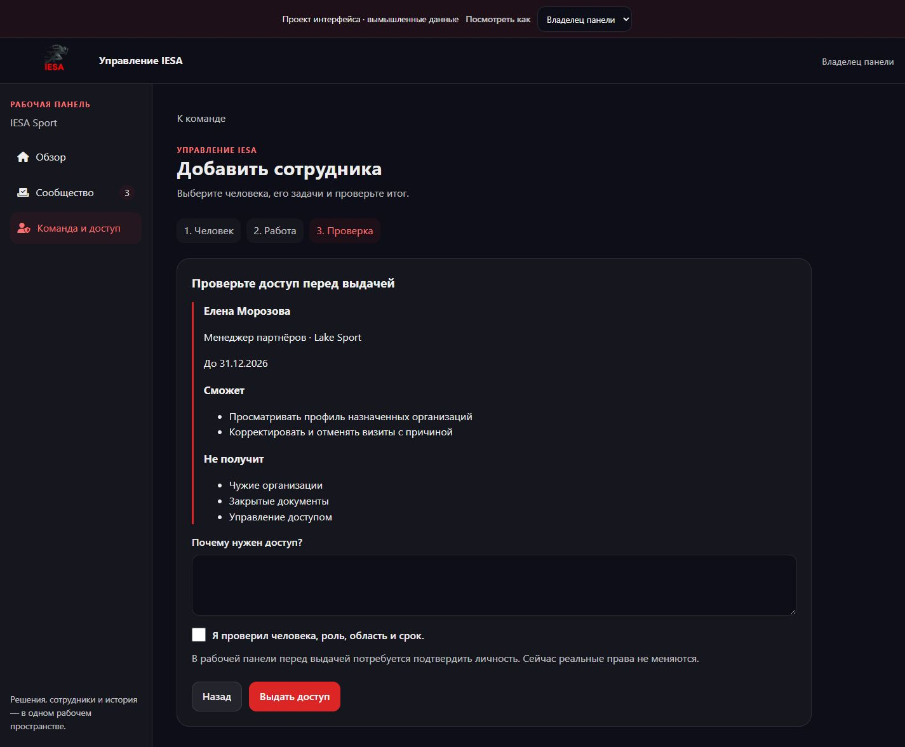
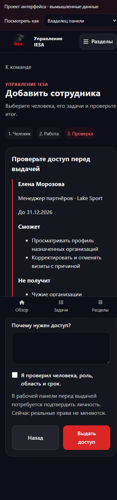

# Прототип интерфейса IESA

14 октября 2026. Демонстрация проекта: **не рабочая админка и не проверка серверных прав**.

Для запуска из папки Django-сайта `IESA_ROOT/`, где находится `manage.py`:

```powershell
python -m http.server 8003 --bind 127.0.0.1
```

Открыть `http://127.0.0.1:8003/docs/admin-workspace/prototype/index.html`.

Используются существующие `static/css/variables.css` и `static/img/logo.png`; иконки — тот же Font Awesome, что на сайте. Другие подключения к серверу, БД, почте или Telegram отсутствуют. Данные вымышленные, изменения живут только в памяти страницы. Обновление возвращает исходные примеры.

## Что можно пройти

1. Обзор → очередь → поиск и выбор статуса → проверка публикации.
2. Попытка возврата без причины → понятная ошибка → возврат с причиной → обновлённая очередь. Или публикация с явным итогом.
3. Команда → добавление человека → роль и организация → срок → резюме → создание назначения.
4. Отзыв назначения с причиной без удаления аккаунта.
5. Переключение «Владелец / Модератор»: недоступные разделы скрываются, прямой переход к команде в режиме модератора возвращает в сообщество. Это иллюстрация будущей policy, а не механизм защиты.

## Проверка 14 октября

- В браузере пройдены назначение роли менеджера для Lake Sport, проверка итоговых прав и сохранение для Елены Морозовой.
- Пройдён отзыв назначения с обязательной причиной.
- В роли модератора проверены очередь, ошибка пустой причины и возврат материала с текстом автора; итог отображается на странице, счётчик очереди уменьшается.
- Проверена мобильная выдача доступа на 360 px и работа на 390 px; горизонтального переполнения в проверенных формах нет.
- На ПК 1440 px проверены резюме назначения и отсутствие переполнения.
- Node `--check`: ошибок нет. В browser console проверенных сценариев ошибок JS нет.
- Это ручная проверка демонстрации. Реальные мобильные устройства, клавиатура iOS, локализация, серверная безопасность и полный набор состояний большой админки не проверены.

## Снимки





## Ограничения

Три рабочие области, две демонстрационные персоны и два шаблона назначения. Без реальной re-auth, серверной проверки срока, фоновой доставки, конкурентного редактирования, хранения аудита и экрана автора. Реализация этих механизмов описана в [уточнённом первом выпуске](../FIRST-RELEASE.md) и [проекте прав](../ACCESS-AND-DELIVERY.md).
