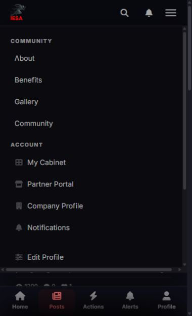
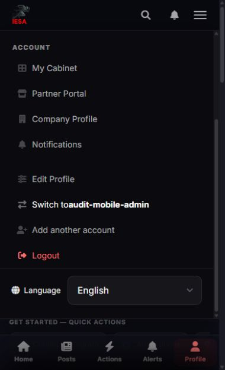
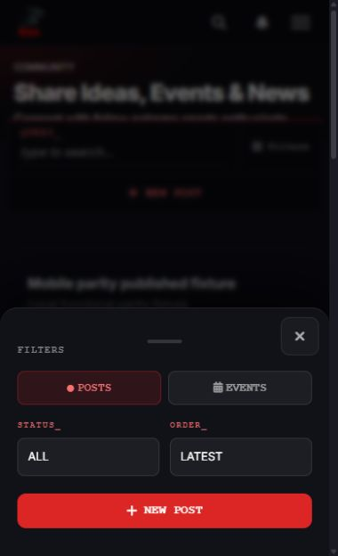
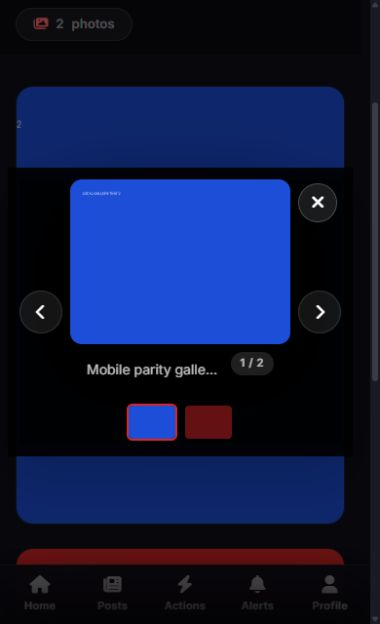
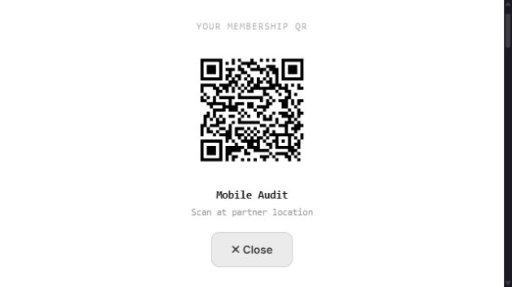
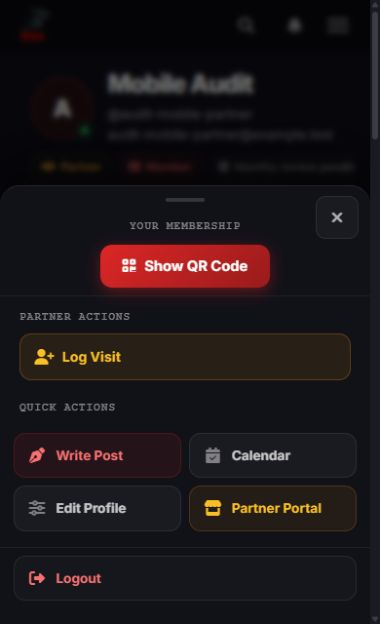
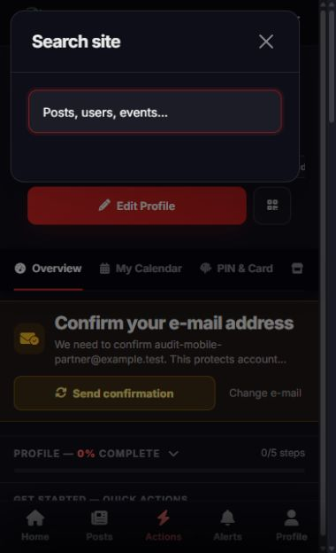

# IESA: аудит случайных закрытий и мобильных взаимодействий

14 октября 2026. Проверялся рабочий Django-сайт IESA, а не макет новой админки. Основа — master `88e176d8`; работа в отдельном checkout, тестовые аккаунты и копия SQLite. Реальные аккаунты и production-БД не изменялись.

**Главный результат:** описанная проблема меню подтверждена в его обработчике: любой вертикальный свайп вверх больше 60 px вызывал закрытие при `touchend`. Обычное пролистывание длинного меню вниз совпадало с этим условием. Закрытие меню жестом удалено; остались кнопка, выбор ссылки, нажатие снаружи и добавленный Escape.

Аудит сочетал текущие снимки и взаимодействия в IAB, чтение обработчиков и исполнение регрессионных сценариев с событиями в изолированном Node-harness. В браузере использовались размеры 390×640 и 640×360; тесты отдельно проверяют desktop-условия и PWA-ветку. Физическое отпускание пальца в iOS Safari/Android не воспроизводилось: доступный browser API позволил проверить прокрутку, клики и клавиатуру, а последовательности touch-событий проверены тестами.

## Проверенные шаги

| № | Шаг | До / находка | Итог |
|---|---|---|---|
| 1 | Открыть бургер и долистать длинное меню | Вертикальная прокрутка ошибочно трактовалась как закрытие; дополнительно горизонтальное переполнение 380/370 px | Закрытие свайпом удалено; ширины меню теперь 370/370 px; нижние действия доступны |
| 2 | Закрыть меню и перейти в поиск | Escape не закрывал меню. После «меню → поиск → закрыть» тело страницы оставалось `overflow:hidden` | Escape возвращает фокус кнопке; окно получает корректный исходный scroll-lock, после закрытия `overflow:''` |
| 3 | Открыть фильтры, закрыть и быстро открыть заново | Старый таймер скрывал backdrop нового окна; повторное open теряло исходную прокрутку; отменённый drag оставлял transform | Открытие идемпотентно, закрытие относится только к текущей панели, timers/RAF/drag защищены |
| 4 | Из меню открыть быстрые действия и вернуться | Закрытие меню снимало блокировку фона открытой панели; закрытие панели могло вернуть устаревшую блокировку меню | Фон остаётся заблокирован при открытой панели и освобождается после закрытия |
| 5 | Открыть QR, прокрутить/закрыть, в том числе горизонтально | Любое движение вниз закрывало QR; повторное open блокировало страницу после close; wake lock не освобождался | Закрытие только явной кнопкой/Escape, возврат фокуса и scroll-state; QR и Close помещаются на 640×360; wake lock освобождается |
| 6 | Открыть фото, переключить и сразу закрыть | Вертикальный диагональный жест/масштабирование могли переключить фото; отложенный `show()` снова открывал закрытый viewer; быстрые Next терялись | Учитывается направление, один палец и отмена; таймеры отменяются при hide; каждый Next учитывается |
| 7 | Прокрутить страницу во время HTMX settle | Общий обработчик возвращал её к прежней позиции, отменяя движение пользователя | Принудительное восстановление удалено; остаются обычное браузерное anchoring и явные правила конкретных элементов |
| 8 | Обновление списков движением вниз | Рисовался индикатор, но `refresh` не имел потребителей; у уведомлений ещё и отсутствовал указанный target | Фиктивный custom pull-to-refresh и неработающие атрибуты удалены; нативное обновление браузера не перехватывается |
| 9 | Жест «назад» в установленном PWA | Мог сработать в открытом окне, на вводе, после touchcancel или диагонального движения | Добавлены ограничения поверхности, состояния, мультитача, направления и отмены; намеренный горизонтальный back сохранён |

Шаги 1–6 проверены визуально и обычными browser-взаимодействиями; точные touch/cancellation/timer-последовательности — event-тестами. Шаги 7–9 подтверждены обработчиками и тестами; реальный PWA и нативное обновление мобильного браузера здесь не запускались.

## Снимки текущего аудита

### 1. Исходное длинное меню



Меню действительно требует внутренней прокрутки: в начальном состоянии `scrollHeight=709`, `clientHeight=488`. Сам снимок не доказывает закрытие после отпускания пальца; причина подтверждена старым `touchend` и воспроизводящим тестом.

### 2. Нижние действия меню после исправления



В финальной версии: `scrollTop=211`, предел 211, класс `show` сохраняется; `scrollWidth=clientWidth=370`. Убрана горизонтальная полоса, кнопки не шире доступной области, длинные имена могут переноситься. Escape закрывает меню и возвращает фокус переключателю.

### 3. Мобильные фильтры



После закрытия и повторного открытия проверены `aria-hidden=false`, backdrop `display:block`, body `overflow:hidden`. Явная кнопка Close имеет цель 44×44 px. Перетаскивание разрешено только ручкой; скролл содержимого не является закрытием. Отмена жеста сбрасывает смещение.

### 4. Галерея



Next, Close и миниатюры доступны на телефоне. В браузере после Next и Close: `show=false`, `display=none`; окно не открылось снова. Тесты отдельно ускоряют последовательность до границы 200 ms и проверяют её без зависимости от скорости browser API.

### 5. QR в горизонтальной ориентации



На 640×360 видны код, подпись и Close. Использован QR вымышленного локального аккаунта. После Close `aria-hidden=true`, body overflow пустой, фокус возвращён кнопке Show QR. Проверка не включает реальное сканирование камерой.

### 6. Быстрые действия



После перехода из открытого меню меню закрыто, panel `aria-hidden=false`, body `overflow:hidden`. После закрытия панели body overflow пустой. Это защищает и от прокрутки фона, и от зависания страницы после возврата.

### 7. Поиск



Окно принимает фокус поиска. В завершённой проверке после Escape: modal без `show`, body без `modal-open`, `overflow:''`. Снимок показывает открытое окно; факт корректного освобождения прокрутки подтверждён отдельным чтением DOM после закрытия.

## Регрессии и проверки

- [`core/tests_interactions.cjs`](../../../core/tests_interactions.cjs): **23 проверки проходят**. Те же сценарии на `88e176d8`: 21 падение, 2 успешных проверки сохранённых намеренных жестов. Это сценарии, а не заявление о 21 независимом пользовательском баге.
- Покрытие: длинное меню/touchend, Escape/focus, desktop click, HTMX-scroll, повторное open, close/reopen/timer, устаревший close, drag-cancel, stale opening RAF, галерея/вертикаль/горизонталь/pinch/cancel/rapid-next/late-show, PWA back/overlay/cancel, QR повторный open/скролл/wake-lock, передача блокировок между слоями и Bootstrap.
- Django: `core.tests_mobile_parity core.tests blog.tests gallery.tests notifications.tests` — **21 тест OK** на финальной версии; system check без ошибок.
- Node syntax checks изменённых JS/service worker — без ошибок. Inline-обработчики меню слоёв/QR/галереи/Bootstrap также реально исполняются в тестах.
- `collectstatic` с `CompressedManifestStaticFilesStorage`: успешно, manifest присутствует. `git diff --check`: чисто.
- Ошибок JavaScript в проверенных browser-сценариях нет.
- Service worker обновлён до `iesa-v8`, версии изменённых JS/CSS обновлены, чтобы старые ресурсы не удерживали исправленный баг.

Запуск event-тестов из корня репозитория:

```powershell
node --test IESA_ROOT/core/tests_interactions.cjs
```

## Границы результата

Это аудит общих мобильных взаимодействий и перечисленных сценариев. Он не доказывает отсутствие любых ошибок на всех страницах, на реальном iOS/Android, при физическом pinch, системном Back или работе камеры. Требуется проверка на устройстве: бургер → прокрутка до конца → отпустить палец; меню → поиск → закрыть → продолжить прокрутку; галерея → вертикальная прокрутка и pinch → Close; панели → прерывание жеста системным действием.

Из скриншотов нельзя заявлять полную accessibility compliance. Проверены явные Close/Escape, часть возврата фокуса и состояния диалогов; screen reader, browser zoom и системная клавиатура требуют отдельной проверки. Неактивный legacy PIN-fullscreen handler обнаружен в profile, но соответствующей разметки в текущем сайте нет; его нельзя считать визуально проверенным рабочим экраном.

Изменения относятся только к Django-сайту IESA. Прототип админки, Predvestnik и `frontend/` не изменялись.
